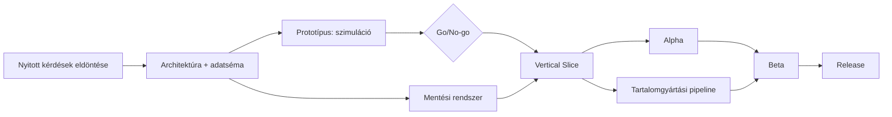

# Ütemterv (Roadmap)

**Státusz:** Vázlat | **Utolsó módosítás:** 2026-11-03

> **Feltevések (módosítandó):** kis csapat (1–3 fő), a becslések relatív hetekben (H) vannak, nem naptári dátumokban. Egy kezdő dátum rögzítése után a hetek dátumokra váltandók. A becslések a `game_design.md` jelenlegi hatóköre alapján készültek, ezért a design változásával frissítendők. A játék szimulációs része (város/NPC/gazdaság) a legnagyobb kockázat, ezért korán prototipizáljuk.

## 1. Fázisok áttekintése
| # | Fázis | Cél | Becsült időtartam | Kimenet |
|---|-------|-----|-------------------|---------|
| 0 | Előkészítés (Pre-production) | Design lezárása, technikai alapok, nyitott kérdések eldöntése | 6 H | Elfogadott design docok, architektúra, projekt váz |
| 1 | Prototípus | Core loop és a gazdasági szimuláció megvalósíthatóságának bizonyítása (szürke dobozos) | 10 H | Játszható prototípus-build, tanulságok jelentés |
| 2 | Vertical Slice | Egy biom + egy bázis + egy frakció minőségi, végleges stílusban | 14 H | Bemutatható, kb. 30–45 perces szelet |
| 3 | Alpha (Feature complete) | Minden rendszer működik, kevés tartalommal | 20 H | Végigjátszható (csúnya) build, minden fő rendszerrel |
| 4 | Beta (Content complete) | Minden tartalom bent, balansz, polírozás | 16 H | Teljes tartalmú build, zárt playtest |
| 5 | Release Candidate és kiadás | Hibajavítás, optimalizálás, kiadási előkészületek | 8 H | 1.0 kiadás |
| 6 | Kiadás utáni támogatás | Hotfixek, tartalmi frissítések | folyamatos | Patchek, DLC/frissítés terv |

Összesen kb. **74 hét (~17 hónap)** a kiadásig, 15% tartalékkal számolva ~85 hét.

## 2. Fázisonkénti részletek

### Fázis 0 – Előkészítés (6 H)
* **Belépési feltétel:** `game_design.md` alapdokumentum létezik.
* **Feladatok:**
  | Hét | Feladat | Kimenet / dokumentum |
  |-----|---------|-----------------------|
  | 1 | `vision.md` kitöltése: pillérek, célközönség, platform, hatókör (MVP) | `00_overview/vision.md` |
  | 1–2 | Nyitott kérdések eldöntése (NPC pénzáramlás, adó/kincstár, életciklus, igény-hiány büntetés, raktárlimit) | `01_design/open_questions.md`, frissített design docok |
  | 2–3 | Core loop, nehézség, frakciók (4 frakció váz), biomok listája | `core_loop.md`, `difficulty.md`, `factions_diplomacy.md`, `world_biomes.md` |
  | 3–4 | Technikai architektúra, adatvezérelt séma, kódolási szabályok, Git/CI | `architecture.md`, `data_driven_design.md`, `coding_standards.md`, első ADR-ek |
  | 4–5 | Unity projekt felállítása, mappastruktúra, assembly definition-ök, build pipeline | Üres, buildelhető projekt, `tools_pipeline.md` |
  | 5–6 | Művészeti irány vázlat, referenciák, szójegyzék, kockázatnyilvántartás, backlog | `art_direction.md`, `glossary.md`, `risk_register.md`, `backlog.md` |
* **Kilépési feltétel:**
  - [ ] Minden nyitott kérdés eldöntött vagy tudatosan elhalasztott
  - [ ] MVP hatókör jóváhagyva
  - [ ] Projekt buildel CI-n
  - [ ] Prototípus backlog priorizálva
* **Fő kockázat:** túl sok tervezés a prototípus előtt; időkeret szigorú tartása.

### Fázis 1 – Prototípus (10 H)
* **Cél:** bizonyítani, hogy a túlélés + város-szimuláció + gazdaság szórakoztató és technikailag kivitelezhető. Grafika: placeholder.
* **Belépési feltétel:** Fázis 0 kilépési feltételei teljesültek.
* **Mérföldkövek:**
  | Hét | Feature | Design doc | Elfogadási kritérium |
  |-----|---------|------------|----------------------|
  | 1–2 | Játékos mozgás, kamera, interakció, inventory alap | `player_character.md`, `items_crafting.md` | Mozgás, tárgy felvétel/használat működik |
  | 3 | Túlélési mutatók (éhség, szomjúság, életerő) és napszak ciklus | `player_character.md`, `time_weather_events.md` | Mutatók csökkennek, nappal/éjszaka vált |
  | 4 | Nyersanyag gyűjtés, alap crafting, egyszerű építés | `items_crafting.md`, `town_management.md` | Fa/kő gyűjthető, tárgy craftolható, épület elhelyezhető |
  | 5–6 | NPC alapok: statok, igények, Lakóház, munkaállomás kiosztás | `npc_system.md` | NPC-k dolgoznak és igényeik csökkenek |
  | 7–8 | Városi mikrogazdaság: termelés, vásárlás/eladás, árrés, utasítási rendszer v1 | `town_management.md`, `trade_economy.md` | Szimuláció 1 játékos-órán át stabil, nem omlik össze |
  | 9 | Alap harc + 1 ellenség típus, éjszakai szörnyek | `combat_enemies.md` | Legyőzhető ellenség, sebzés/halál működik |
  | 10 | Playtest, mérés, értékelés, go/no-go | `balance_plan.md`, `performance.md` | Tanulságok jelentés |
* **Kilépési feltétel (go/no-go):**
  - [ ] A core loop 30 percig szórakoztató (playtest visszajelzések alapján)
  - [ ] 20+ NPC szimulációja célhardveren ≥ 60 FPS
  - [ ] Gazdasági modell stabil (nincs infláció/összeomlás 2 órás szimuláció alatt)
  - [ ] Architektúra bővíthető (új igény hozzáadása kódmódosítás nélkül, adattal)
* **Fő kockázatok:** szimuláció teljesítménye, gazdasági egyensúly; vészterv: egyszerűsített gazdasági modell.
* **Nem cél:** végleges grafika, mentés, frakció-diplomácia, történet.

### Fázis 2 – Vertical Slice (14 H)
* **Cél:** a végleges minőség és stílus bizonyítása; ezzel készül a bemutató/pitch/első külső visszajelzés.
* **Hatókör:** kezdő biom, 1 frakció és fővárosa, 1 bázis (Lakóház, Bányász, Favágó, Farmer, Kocsma), 1 boss, 1 helyőrség-elfoglalás.
* **Mérföldkövek:**
  | Hét | Feature | Design doc |
  |-----|---------|------------|
  | 1–2 | Végleges művészeti stílus: karakter, biom, UI kit, asset pipeline | `art_direction.md`, `asset_pipeline.md`, `ui_ux.md` |
  | 3–4 | Mentési rendszer v1 (bázis, NPC, inventory) | `save_system.md` |
  | 5–6 | Kasztrendszer v1 (2 kaszt: pl. Harcos, Builder), skillfa váz, XP | `player_character.md` |
  | 7–8 | Teljes városmenedzsment v1: épületek, igények, morál, Iskola, Kocsma + random quest | `town_management.md`, `npc_system.md` |
  | 9 | Frakció fővárosa: diplomácia v1, kereskedő, egyedi küldetések | `factions_diplomacy.md`, `story_quests.md` |
  | 10–11 | Helyőrség-elfoglalás + boss fight + biom-feloldás | `world_biomes.md`, `combat_enemies.md` |
  | 12 | UI/UX teljes kör a szeleten, hang és zene alap | `ui_ux.md`, `audio_direction.md` |
  | 13–14 | Polírozás, optimalizálás, playtest (5–10 külső tesztelő) | `test_plan.md`, `balance_plan.md` |
* **Kilépési feltétel:**
  - [ ] 30–45 perces folyamatos, hibamentes végigjátszás
  - [ ] Minden szelet-rendszer végleges UI-val és grafikával
  - [ ] Külső playtest pozitív arányú visszajelzése (cél: >70%)
  - [ ] Tartalomgyártási becslés (idő/elem) megvan az Alpha/Beta tervezéséhez
  - [ ] Hatókör újraértékelve (felülvizsgált roadmap)

### Fázis 3 – Alpha / Feature complete (20 H)
* **Cél:** minden tervezett rendszer implementált és integrált, tartalom még hiányos.
* **Mérföldkövek:**
  | Hét | Feature | Design doc |
  |-----|---------|------------|
  | 1–3 | Mind a 7 kaszt, teljes skillfa, varázslat- és képességrendszer | `player_character.md` |
  | 4–6 | Mind a 4 frakció, diplomácia mélység (viszonymátrix, következmények), 4 főváros | `factions_diplomacy.md` |
  | 7–9 | Összes biom + biomprogresszió, helyőrségek, több bázis kezelése | `world_biomes.md`, `town_management.md` |
  | 10–11 | Logisztikai hálózat (szállítmányok, biomközi nyersanyagok) | `town_management.md` |
  | 12–13 | NPC életciklus, viszonyok, random események, zsoldos seregek, felszerelés | `npc_system.md` |
  | 14 | Teljes item ökoszisztéma: ritkaság, minőség, minden típus, loot | `items_crafting.md` |
  | 15 | Vándorkereskedő, Piac, gazdasági finomhangolás | `trade_economy.md` |
  | 16 | Special eventek (Telihold, Vérhold, Ünnep), időjárás | `time_weather_events.md` |
  | 17 | Nehézségi szintek teljes implementációja, több befejezés keretrendszere | `difficulty.md`, `story_quests.md` |
  | 18 | Mentés teljes lefedettség és migráció, lokalizációs váz | `save_system.md` |
  | 19–20 | Stabilizálás, bug-fix, belső playtest, teljesítmény-audit | `test_plan.md`, `performance.md` |
* **Kilépési feltétel:**
  - [ ] Minden `game_design.md` rendszer implementált (placeholder tartalommal is)
  - [ ] Elejétől végéig végigjátszható mind a 3 nehézségen
  - [ ] Nincs ismert crash/adatvesztő hiba
  - [ ] Funkciózárlat (Feature Freeze): új feature csak jóváhagyással

### Fázis 4 – Beta / Content complete (16 H)
* **Cél:** minden tartalom bent, balansz és polírozás.
* **Mérföldkövek:**
  | Hét | Feladat |
  |-----|---------|
  | 1–5 | Tartalomgyártás: összes küldetés, párbeszéd, ellenség, boss, item, recept, épület véglegesítése |
  | 3–6 | Végleges grafika, animáció, VFX, zene, SFX integrálása |
  | 5–8 | Történet és befejezések lezárása, frakcióküldetések összekötése |
  | 7–10 | Balansz: gazdaság, harc, nehézségi szintek, progressziós tempó |
  | 9–11 | UI/UX polírozás, akadálymentesség, lokalizáció (HU + EN) |
  | 11–13 | Teljesítmény-optimalizálás, memória, betöltési idők |
  | 12–16 | Zárt béta playtest (20–50 fő), visszajelzés, bug-fix hullámok |
* **Kilépési feltétel:**
  - [ ] Content Lock: új tartalom nincs
  - [ ] Nincs blokkoló/súlyos hiba a hibakövetőben
  - [ ] Teljesítménycélok minden célplatformon teljesülnek
  - [ ] Három nehézség végigjátszva, a balansz célok teljesülnek

### Fázis 5 – Release Candidate és kiadás (8 H)
* **Mérföldkövek:**
  | Hét | Feladat |
  |-----|---------|
  | 1–2 | Csak kritikus hibajavítás (Code Freeze), RC build |
  | 2–4 | Store oldal, trailer, képernyőképek, sajtókészlet, jogi anyagok (licencek, credits) |
  | 4–6 | Platform-minősítés, utolsó regressziós tesztkör |
  | 7 | Gold master, kiadási ellenőrzőlista végigvitele (`04_production/release_checklist.md`) |
  | 8 | Kiadás és élő monitorozás |
* **Kilépési feltétel:** kiadási ellenőrzőlista 100%-ban teljesítve.

### Fázis 6 – Kiadás utáni támogatás
* Hotfix SLA: kritikus hiba 72 órán belül.
* Első nagy javítócsomag a kiadás után 4–6 héttel (balansz, QoL).
* Lehetséges tartalmi bővítések: új frakció/biom, mod-támogatás, új kasztok (a bővíthető architektúrára építve).

## 3. Függőségek és kritikus útvonal

**Kritikus útvonal:** nyitott kérdések → adatséma → gazdasági szimuláció → mentési rendszer → tartalomgyártás → balansz.

| Feladat | Függ tőle | Miért blokkol |
|---------|-----------|----------------|
| Gazdasági modell döntések (pénzáramlás, adó) | Városmenedzsment, kereskedelem, NPC | Nélkülük nem implementálható a szimuláció |
| Adatvezérelt séma | Minden tartalom (item, épület, igény) | Utólagos átállás drága |
| Mentési rendszer | Minden állapotot tároló rendszer | Későn bevezetve minden rendszert át kell írni |
| Végleges művészeti stílus | Asset gyártás | Stílusváltás = újragyártás |
| Frakció-rendszer | Küldetések, kereskedelem, biom-hozzáférés | Több rendszer épül rá |

## 4. Döntési kapuk (Gate Review)
| Kapu | Fázis vége | Döntéshozók | Kérdés | Lehetséges kimenet |
|------|------------|-------------|--------|---------------------|
| G0 | Előkészítés | Teljes csapat | Elég stabil a design a prototípushoz? | Tovább / további tervezés |
| G1 | Prototípus | Teljes csapat | Szórakoztató és kivitelezhető? | Tovább / hatókör szűkítés / pivot |
| G2 | Vertical Slice | Teljes csapat | Minőség és becslések rendben? | Tovább / hatókör csökkentés |
| G3 | Alpha | Teljes csapat | Feature complete? | Tovább / késleltetés |
| G4 | Beta | Teljes csapat | Content complete, stabil? | Tovább / késleltetés |
| G5 | RC | Teljes csapat | Kiadható? | Kiadás / javítás |

## 5. Hatókörcsökkentési terv (ha csúszás van)
Sorrend, amit először elhagyhatunk/egyszerűsíthetünk:
1. Zsoldos seregek és NPC-viszony események mélysége
2. Special eventek száma (Ünnepek), időjárás-típusok
3. Kasztok száma (7 → 4–5), skillfa mélysége
4. Logisztikai hálózat egyszerűsítése (automatikus szállítmány helyett manuális)
5. Befejezések száma
6. Frakciók száma (4 → 3)

**Nem csökkenthető (pillérek):** túlélés, városmenedzsment alapok, frakció-viszony, bővíthető architektúra.

## 6. Mérőszámok és nyomon követés
* Heti állapotfrissítés: kész / folyamatban / blokkolt feladatok a `04_production/backlog.md`-ben.
* Mérföldkövenként retrospektív a `04_production/milestones.md`-ben.
* Velocity: tervezett vs. teljesített feladatok sprintenként; ha 2 sprinten át <70%, roadmap-felülvizsgálat.
* Kockázatok havi áttekintése: `04_production/risk_register.md`.

## 7. Változásnapló
| Dátum | Változás | Indok |
|-------|----------|-------|
| 2026-11-03 | Részletes roadmap első verziója | Kezdeti tervezés |
